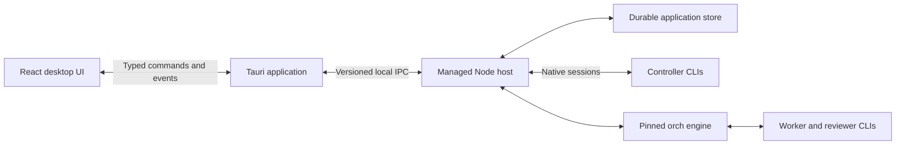

# CHO Desktop — Product and Release Specification

Version: 0.2 — validated-review revision  
Date: 2026-10-30  
Target: Windows-first public v0.1 release

## 1. Product intent

CHO is a desktop workspace for working with existing coding CLI subscriptions and coordinating agents through `orch`.

The user opens a repository, selects a controller CLI and model, and has a continuing conversation with that agent. The controller can delegate scoped work to other CLIs. The user can follow their activity, inspect changes, review results, and decide what to keep without managing a collection of terminals.

The experience should feel as coherent and usable as Codex or Claude desktop: conversation first, clear project context, quiet controls, and detailed activity available when needed. CHO retains its own identity and implementation.

The default appearance is neutral dark: graphite surfaces, soft grey text, subtle borders, restrained status colour, and clear typography. The current redesigned shell is the visual starting point.

### Product outcomes

1. Existing CLI installations and saved sign-ins are useful from one desktop application.
2. Conversations and agent work remain understandable across turns, restarts, and failures.
3. Delegated changes have clear ownership, isolation, verification, and review evidence.
4. Users understand and control actions affecting their repositories.
5. Someone other than the developer can install and use the released application using the documented prerequisites.

## 2. Scope and release boundaries

This document turns the agreed product direction into proposed implementation requirements. Defaults below define the first release; they are not claims that the current implementation already satisfies them.

| Area | v0.1 scope |
| --- | --- |
| Platform | Windows 11 x64 is the initial qualification target. Other Windows versions and architectures require separate evidence before being advertised. |
| Application | Installed Tauri application with a bundled, managed backend. Development browser mode remains useful for development. |
| Controllers | At least two fully qualified controller integrations. Claude Code and Codex are the initial candidates; this is a qualification target, not a current support claim. |
| Other CLIs | Antigravity, Grok, Muse, Copilot, Vibe, and OpenCode remain integration candidates. Antigravity must be evaluated as a real controller integration, not merely shown in a selector. |
| Delegation | Qualified implementation and review routes using different actual models, through the existing coordinator. |
| Credentials | Use native CLI authentication. Do not copy provider credentials into CHO or redistribute authenticated CLI installations. |
| Repository integration | Git repository selection, isolated implementation worktrees, readable diffs, review results, and explicit integration/discard decisions. |
| Storage | Durable local application data, native session references, event history, and operation records. |
| Distribution | Public source repository and downloadable Windows installer with documented prerequisites and release evidence. |

An integration is not supported simply because an executable was found or its synthetic parser tests pass. Unsupported operations must be hidden or clearly disabled. Experimental integrations must be explicitly enabled and labelled.

### Deferred from the required v0.1 release

- macOS and Linux desktop packaging and qualification.
- Hosted accounts, team collaboration, remote execution, and cloud synchronization.
- Plugin marketplaces, extensibility APIs, and elaborate analytics.
- Built-in installation of coding CLIs or automated provider sign-in.
- Automatic updates; documented manual upgrades are sufficient initially.
- LAN companion access. If included experimentally, it must pass the separate network-access gate in section 7; it must not delay the local desktop release.

The inherited coordinator may support additional platforms or adapters. That does not automatically qualify the corresponding desktop feature.

## 3. Current baseline

The repository contains a redesigned React interface, a Node bridge, a Tauri scaffold, an event-normalization package, and the inherited `orch` engine. The last local UI work passed a frontend build, typecheck, and 12 package/UI tests. Those results do not establish native packaging or live CLI qualification. The independent review on 2026-10-30 observed a cold-discovery test timeout; a subsequent controller run passed all 12 tests. That variability is a test-isolation defect to fix, not grounds to erase the earlier dated result.

Known gaps at specification time, with foundation progress tracked in [IMPLEMENTATION_STATUS.md](IMPLEMENTATION_STATUS.md):

- Native commands expose only discovery and dashboard operations; the complete UI does not work through the native transport.
- Direct chat launches a new CLI process per turn and pastes a short transcript instead of resuming a native conversation.
- UI conversation persistence uses browser storage rather than an application-owned session store.
- Normalization logic is duplicated between the bridge and the nominal shared package.
- Several direct-chat launch paths bypass approval mechanisms.
- At specification time the standalone bridge exposed all-interface listening and wildcard CORS. The foundation batch narrows development defaults to loopback and adds a hostile-web-origin request boundary; production private IPC and local-user authorization remain separate requirements.
- The delegation form now orders claim, worktree creation, and run submission, with focused mock tests. Full lifecycle recovery and installed-app acceptance remain unqualified.
- The current Git remote points to `cli-agentic-coordinator`; the prototype is now checkpointed locally. The inherited coordinator selection ignores `apps/**` and `packages/**`; the foundation batch adds an independent desktop workflow. Hosted execution remains unverified until it runs.
- The README describes capabilities more broadly than the current evidence supports.

## 4. Primary user journeys

### 4.1 First launch

1. Install and open CHO without manually starting a server.
2. See backend readiness and available coding CLIs.
3. Receive clear guidance for missing Git, unavailable CLIs, unsupported versions, or required native sign-in.
4. Choose a repository using a native folder picker.
5. Choose a qualified controller and an available model route.
6. Start a conversation. Provider qualification calls are explicit, bounded actions, not an automatic side effect of discovery.

### 4.2 Continuing work

1. Send a message and see readable responses and tool activity.
2. Answer permission or clarification requests where supported.
3. Switch conversations without losing drafts or confusing their output.
4. Close and reopen CHO, then resume a persisted native conversation.
5. If the native session cannot be resumed, see an explanation and an explicit option to start a new conversation with a context handoff.

### 4.3 Delegated change

1. Discuss a change with the controller.
2. Review the proposed task scope, worker, reviewer, and verification plan; approve the delegation plan before implementation starts.
3. See implementation progress in the conversation's Agents panel.
4. Inspect changed files and a readable diff.
5. See scope and verification results and an independent review.
6. Request another round, accept the result, or discard it.
7. Separately authorize integration into the target branch. Acceptance alone must not merge, push, delete branches, or remove worktrees.

### 4.4 Interrupted work

On reconnect or restart, CHO reconciles recorded work with the coordinator and process evidence. It distinguishes running, interrupted, failed, finished, and unknown work. It never silently relaunches an interrupted task, replays an approval, or infers success from missing output.

## 5. Architecture

Retain Tauri, React, and the coordinator. Replace the incomplete desktop integration with one persistent application-owned Node host. Do not rewrite the coordinator to implement a desktop UI.

### Architectural requirements

| ID | Requirement |
| --- | --- |
| ARCH-01 | Bundle the backend runtime/resources. Resolve packaged resource paths independently of the source checkout, working directory, or a globally installed Node executable. |
| ARCH-02 | Run one managed host per application instance. Handle startup handshake, version mismatch, startup failure, host exit, restart, and graceful shutdown. Avoid duplicate hosts on repeated launch. |
| ARCH-03 | Route every desktop operation through one typed, versioned contract. The browser development transport must implement the same command and event semantics. |
| ARCH-04 | Use one canonical event normalizer with harness-specific adapters. Use ACP only where the actual CLI supports it; native stream protocols remain valid alternatives. |
| ARCH-05 | Use a pinned coordinator snapshot/version with recorded provenance and an explicit upstream update process. Keep desktop concerns outside coordinator internals wherever practical. |
| ARCH-06 | Break the large UI component into conversation, composer, projects, connections, activity, diff/review, and dialog components. Keep subprocess and workflow policy out of presentation components. |
| ARCH-07 | The production desktop path must not depend on Vite, a development server, fixed development ports, or source files outside the installed bundle. |
| ARCH-08 | Before host extraction, check native build prerequisites and exercise a packaged-host smoke. The initial bundling approach is a pinned Node runtime plus packaged JavaScript resources managed by Tauri; record a change only if the smoke identifies a concrete reason. |

The recommended host transport is stdin/stdout or a user-scoped local pipe, mediated by Tauri. The final transport choice must demonstrate request correlation, streaming, cancellation, bounded messages, and access control. A local HTTP server is not required for the desktop path.

## 6. Functional requirements

### Projects and conversations

| ID | Requirement |
| --- | --- |
| SESSION-01 | Establish per-controller resume/approval/cancellation capabilities before freezing native-reference persistence contracts. Persist stable project, conversation, turn, and native session identifiers in application-owned storage. Use a schema with migrations and crash-safe writes; SQLite is the default implementation choice. |
| SESSION-02 | Preserve messages, drafts, tool activity, selected harness/model, conversation title, archive state, and parent/child agent relationships across restarts. |
| SESSION-03 | Resume native sessions for qualified controllers. An unsupported or failed resume must produce an explicit recovery choice, never a silent short-transcript substitute. |
| SESSION-04 | Define whether model changes can continue a native session. Changing harnesses must create a new native session with an explicit context handoff unless genuine shared-session semantics exist. |
| SESSION-05 | Keep each project's events, drafts, approvals, and tasks isolated. Associate worktrees with their recorded source repository; do not use repository-name substring matching. |
| SESSION-06 | Provide rename, archive/unarchive, conversation search, and export. Migrate existing browser-stored conversations as transcript imports without inventing native session IDs. |

### Harness and model integration

| ID | Requirement |
| --- | --- |
| CLI-01 | Discover executable path and version separately from sign-in, model access, and role qualification. Do not treat a credential-file presence hint as verified authentication. |
| CLI-02 | Maintain a capability matrix per tested CLI version: native sessions, resume, structured output, tool calls/results, approval requests, cancellation, model selection, reasoning effort, and controller/worker/reviewer roles. |
| CLI-03 | Separate discovered model choices, requested model, and model actually reported by the execution. Unknown provenance remains unknown; configured/requested model values are not proof of the served model. |
| CLI-04 | Explain blocked sign-in, quota, unavailable model, unsupported version, and protocol failure distinctly. Do not automatically change model, billing route, or provider. |
| CLI-05 | Use native authentication and direct supported executables. Environment filtering is one control, not proof that a launch uses subscription billing; inspect and qualify the effective route before making that claim. |
| CLI-06 | A controller advertised as interactive must support its required approval and clarification flow. If an integration cannot provide that flow, restrict its available roles/modes rather than silently enabling unrestricted execution. |

### Streaming and process lifecycle

| ID | Requirement |
| --- | --- |
| RUN-01 | Normalize status, response text, tool invocation/result, approval, clarification, model attribution, usage when available, and terminal events. Keep raw protocol output in optional diagnostics, not the conversation. |
| RUN-02 | Handle split frames, partial final lines, malformed events, repeated snapshots, and duplicate delivery without corrupting text or repeating terminal events. |
| RUN-03 | Serialize turns within a native session. Simultaneous conversations must remain independent, subject to coordinator lane limits and actual CLI capabilities. |
| RUN-04 | Persist events before acknowledging durable progress. Reconnect using event cursors; do not replay user actions to recover display state. |
| RUN-05 | Cancellation must track the correct process identity and respect coordinator ownership. Do not terminate unrelated CLI sessions or claim all descendants stopped without evidence. |
| RUN-06 | Define window-close behaviour. Direct sessions must be gracefully interrupted or explicitly detached where supported. Coordinator-supervised work must follow an explicit continue/stop policy and remain discoverable after the UI closes. |
| RUN-07 | Use actionable states: starting, working, waiting for approval, waiting for user, cancelling, completed, failed, cancelled, interrupted, and unknown. Provider completion and product-level acceptance are separate facts. |

### Delegation, changes, and review

| ID | Requirement |
| --- | --- |
| ORCH-01 | Link conversation, work package, task/slice, claim owner, worktree, implementation run, verification, review rounds, and disposition using stable IDs. |
| ORCH-02 | Before implementation, validate the repository, claim ownership, approved handoff/allowlist, worker route, and isolation. Refuse ambiguous or incomplete preparation; do not fall back to the main checkout. |
| ORCH-03 | Persist preparation stages and resource identities so a failed launch can be inspected or resumed without creating duplicate claims, worktrees, or workers. Resources created before a failure remain visible. |
| ORCH-04 | Present real coordinator scope results and recorded verification evidence. Missing, stale, skipped, or failed checks must not appear as passing. |
| ORCH-05 | Use the coordinator's blinded review and actual-model separation rules. Show findings and their disposition; permit another implementation/review round. |
| ORCH-06 | Provide a changed-file list and integrated diff viewer. Opening a file reference must resolve to the correct repository/worktree and show its path clearly. |
| ORCH-07 | Keep finish, acceptance, integration, and cleanup distinct. Recording an accepted ledger entry alone must not imply review convergence or authorize Git mutations. |
| ORCH-08 | Default activity to the active conversation/project. Historical or cross-project activity requires an explicit view and must not be presented as children of the current controller. |
| ORCH-09 | The application host owns coordinator claims and execution admission. Controllers submit delegation proposals tied to a conversation, scope, route, and approval. A prompt alone is not enforcement: the selected native tool/approval/isolation boundary must prevent unapproved delegation from bypassing admission. If a controller cannot provide that boundary, gate that delegation capability instead of claiming it is enforced. |

## 7. Security and user control

These requirements address the concrete access exposed by a coding-agent desktop application. They do not require a new security framework around each routine UI action.

| ID | Requirement |
| --- | --- |
| SEC-01 | Use application-owned local IPC by default. No unauthenticated execution listener on all network interfaces. Browser development access must also reject unauthorized callers. |
| SEC-02 | Validate typed command arguments, message sizes, repository paths, and resource identities at the host boundary. Invalid or missing workspaces must be rejected rather than replaced with the CHO source directory. |
| SEC-03 | Replace blanket permission bypass defaults with explicit, capability-aware policies. Show the action, scope, and relevant arguments before a decision is needed. A read-only mode must not silently retain write/shell access. |
| SEC-04 | Bind approvals to the pending native request, session, action, and current process generation. Cancelled, expired, restarted, or already answered requests cannot authorize later work. |
| SEC-05 | Preserve native CLI credentials in their native stores. Do not log credentials, collect them in CHO, or include them in exports/support bundles. No telemetry by default in v0.1. |
| SEC-06 | Render agent text and Markdown as untrusted content. Prevent script execution and avoid automatically opening links or executing commands found in responses. |
| SEC-07 | Apply a production content security policy and narrow Tauri capabilities appropriate to the implemented command surface. |
| SEC-08 | If LAN companion access is shipped, require explicit activation, authenticated clients, protected credentials/traffic, origin and request validation, and a visible way to revoke access. Browser origin checks alone are not authentication. No insecure fallback. |

Use task-sized permissions that users can understand. Do not add repeated approval prompts for already authorized actions within their stated scope.

## 8. Interaction and visual quality

The redesigned shell establishes the design direction; production quality includes active, empty, loading, failure, recovery, and permission states.

- Keep the conversation central. Projects belong in the sidebar; harness/model controls belong near the composer; agent activity and changes open on demand.
- Preserve graphite dark as the default. The optional light appearance follows the same hierarchy. Avoid gradients, neon accents, emoji status walls, and unnecessary badges.
- Show human-readable action names. Work-package IDs, raw logs, protocol frames, and executable arguments belong in appropriate detail views unless needed for a decision.
- Use a maintained Markdown renderer with safe links, code blocks, copying, lists, tables, and file references. Do not extend the current regex renderer into a bespoke Markdown engine.
- Provide keyboard navigation, visible focus, labelled controls, modal focus management, reduced-motion support, and readable contrast.
- Support the default 1360 × 880 window and 960 × 720 without clipped primary actions or horizontal page overflow; keep the composer usable with activity open. Verify Windows display scaling at 100%, 125%, and 150%.
- Do not force-scroll someone reading earlier output. Indicate new activity and offer a return-to-latest action.
- Make reconnecting, expired sign-in, quota exhaustion, failed launch, and unavailable files understandable and recoverable.
- Use actual state and evidence. Do not display decorative success ticks, guaranteed billing claims, invented progress percentages, or inferred authentication.

## 9. Data, diagnostics, and responsiveness

- Store application data under a per-user application-data directory, separate from source code, provider credentials, and coordinator evidence. Remove hard-coded developer paths and private gateway defaults from shipped configuration.
- Maintain a versioned schema and migrate safely on upgrade. Back up before a destructive migration. A failed migration must preserve the previous data and explain recovery.
- Define retention and user controls for transcripts and diagnostics. Exports/support bundles must be inspectable and redacted. Uninstall must document whether user data is retained; an explicit data-removal action is separate.
- Keep overview reads lightweight. Do not run Git checks across every recorded worktree on each UI refresh. Live scope/verification checks are explicit operations.
- Bound in-memory output and paginate/virtualize long histories. Do not lose persisted text when bounding the visible view.
- Establish a documented Windows test machine and release-build performance fixture. Initial acceptance targets: composer typing and local navigation remain responsive during streaming; cached conversation lists appear within one second; a warm local send shows a starting state within 250 ms; reconnect and host failure become visible within ten seconds. Measure provider response latency separately.

## 10. Qualification and test strategy

### Automated tests

Use deterministic fake CLIs and protocol fixtures for host/integration tests. CI must not consume provider subscriptions or require personal sign-ins.

Cover session creation/resume, cross-session isolation, pending approvals, cancellation, child exit/error events, host restart, cursor replay, duplicate commands/events, malformed output, quota/auth failures, preparation failure after each stage, conflicting claims, worktree ownership, read-only policy, invalid paths, and imports/migrations.

Add UI journey tests for onboarding, project selection, controller selection, conversation persistence, draft retention, activity association, permission decisions, diff inspection, and error recovery. Add native packaged-app smoke tests; a browser-only test is not a substitute.

### Real CLI qualification

For every advertised CLI/version/role, record the tested executable version, route, date, fixture, observed model provenance, relevant capabilities, and result. Authentication, route access, task capability, and controller operation are separate results.

Run bounded tests in owned fixtures after explicit authorization. Include a real multi-turn resume, streamed tool activity, supported approval/clarification behaviour, cancellation, and a coding/review task appropriate to the claimed role. Retest affected capabilities when the CLI protocol or launch configuration changes.

No integration is promoted to supported using only selector presence, a successful executable launch, mocked tests, or another CLI's evidence.

## 11. Implementation work packages

The packages describe deliverables, not permission to launch worker CLIs or publish changes. Each implementation handoff should name its actual files, verification, and scope.

| Package | Deliverable | Depends on | Exit evidence |
| --- | --- | --- | --- |
| CHO-01 | Establish the product source boundary, public/private configuration separation, coordinator provenance, and desktop CI entrypoints. | None | Clean proposed public tree; reproducible dependency installation; desktop checks run in CI. |
| CHO-02 | Persistent native host, versioned command/event transport, packaged resource resolution, and local access boundary. | CHO-01 | Installed-shell commands and streaming work; startup/exit/restart tests; no development server or external Node dependency. |
| CHO-03 | Durable session/event store, native session references, recovery, transcript migration, and conversation operations. | CHO-02 | Restart/resume and cross-session isolation tests; migration/export evidence. |
| CHO-04 | Canonical adapters, capability matrix, native approvals/clarifications, effective route checks, and controller qualification. | CHO-02, CHO-03 | At least two qualified controllers; unsupported capabilities visibly gated; bounded real-run receipts. |
| CHO-05 | Recoverable delegation lifecycle, project/agent associations, verification/review rounds, and explicit finish/integration decisions. | CHO-03, CHO-04 | A complete implementation/review journey; failure-stage tests; preserved coordinator rules. |
| CHO-06 | Product UI completion: onboarding, native folder selection, Markdown/file references, diff/review interface, shortcuts, and recovery states. | CHO-03; agent/review surfaces also need CHO-05 | Native user-journey checks; visual, keyboard, scaling, and accessibility verification. |
| CHO-07 | Installer/release pipeline, application branding, dependency notices, privacy/security documentation, and truthful support matrix. | CHO-01, CHO-02; release candidate also needs CHO-04–06 | Versioned release artifact, checksums, public-tree scan, and release notes matching qualified features. |
| CHO-08 | Clean-machine acceptance and release-candidate fixes. | CHO-01–07 | All mandatory acceptance criteria below pass on the release artifact; known limitations documented. |

Start with CHO-01 and CHO-02. Include working desktop CI coverage in the first CI slice, check native build/runtime bundling before host extraction, and investigate controller transports before freezing session persistence. Qualify worker routes only when the next real slice needs them. Additional visual expansion should follow stable host/session contracts. The primary implementation workforce is Muse CLI and Aider with the requested Qwen/dspark routes; the controller independently reviews their work.

## 12. Public repository and distribution

Create a distinct CHO repository without accidentally pushing desktop changes to the coordinator remote. Preserve useful upstream history/provenance and record the selected coordinator version. Repository creation, pushes, and release publication are separate authorized actions, not consequences of writing this specification.

Before public source publication:

- Review the proposed tracked files and any history being transferred for credentials, personal configuration, machine-specific paths, runtime evidence, and private material.
- Commit the intended source and dependency lockfiles. Keep logs, credentials, generated binaries, local state, and private rosters/configuration out of the public tree.
- Audit copied code/assets and dependency licenses. The current root is MIT; the referenced Grok desktop project's license is Apache 2.0. Establish what was actually reused and retain applicable license, copyright, change, and notice information.
- Replace inherited overclaims with a CHO README: purpose, screenshots, supported platform/CLI matrix, prerequisites, development setup, known limitations, and coordinator relationship.
- Include contribution guidance, issue templates, a security-reporting route, privacy/data-storage notes, and a changelog.

Before distributing a usable installer:

- Build the frontend, native shell, and bundled host through CI. Test the code actually included in the release artifact.
- Produce a versioned Windows installer with application icons, correct metadata, checksums, and release notes.
- Test installation, launch, upgrade with existing data, and uninstall on a clean Windows account/machine with the documented Git/CLI prerequisites and no developer Node/Rust toolchain.
- Establish code signing for the polished Windows distribution. If an experimental build is unsigned, label it clearly and document the limitation; signing is not a prerequisite to publishing source.
- Support manual upgrades without silent data loss or unsupported schema downgrade.

A public source preview may precede the product release if its experimental status and unsafe/incomplete features are accurately described. Do not invite people to run exposed execution endpoints with unsafe defaults.

## 13. v0.1 acceptance criteria

| ID | Scenario | Required result |
| --- | --- | --- |
| AC-01 | Install on the documented clean Windows environment. | App launches its bundled host without a terminal, source checkout, global Node, or development server. |
| AC-02 | Missing CLI, expired sign-in, unsupported version, or inaccessible model. | Distinct useful guidance; no fabricated readiness or automatic provider/billing fallback. |
| AC-03 | Complete several tool-using turns, close CHO, reopen, and continue. | The same supported native session resumes with its actual context and persisted UI history. |
| AC-04 | Change project/conversation while output is streaming; restart after drafting. | Events stay with their owners, drafts persist, and unrelated activity is not attached to the new conversation. |
| AC-05 | Request an approval, reject it, cancel the turn, then restart the host. | No denied action executes; no stale approval or duplicate turn is replayed. |
| AC-06 | Start a delegated change with approved scope. | Claim/worktree preparation succeeds before one worker launches; the main checkout is not used as a fallback. |
| AC-07 | Fail or disconnect during preparation and execution. | Persisted stages/resources reconcile correctly; no silent relaunch, duplicate worker, or destructive automatic cleanup. |
| AC-08 | Finish implementation and request review. | Actual scope/verification evidence and an independent-model review are visible with the changed-file diff. |
| AC-09 | Accept, integrate, or discard a result. | Each action has clear effects; acceptance does not secretly merge, push, delete, or imply unperformed checks. |
| AC-10 | Cancel work while unrelated CLI sessions run. | Only the owned execution is targeted; uncertain process state remains explicit. |
| AC-11 | Send malformed IPC, an invalid workspace, or an unauthorized network request. | The request is refused before execution; private paths/credentials are not disclosed in diagnostics. |
| AC-12 | Use supported sizes, scaling, keyboard navigation, and long conversations. | Primary actions remain usable, output remains readable, and typing/navigation remain responsive. |
| AC-13 | Upgrade with existing sessions and simulate migration failure. | Data survives; failure preserves recoverable prior data and gives useful guidance. |
| AC-14 | Build the proposed public release in CI. | Desktop, host, adapter, and relevant coordinator checks run; fixtures need no personal credentials; artifact provenance and checksums are available. |
| AC-15 | Compare README/support matrix with qualification receipts. | Advertised platform, CLI, role, model-route, and lifecycle capabilities are supported by evidence for the release configuration. |

The release is ready when a new user can install CHO, connect an existing supported CLI login, open a repository, complete and review a delegated change, close the app, and resume their work later, with the control and recovery behaviour specified above.

## 14. Technical references

These references informed the packaging/provenance direction; they do not prove that CHO implements it.

- [Tauri: Node.js as a sidecar](https://v2.tauri.app/learn/sidecar-nodejs/)
- [Tauri: Windows installer](https://v2.tauri.app/distribute/windows-installer/)
- [Tauri: GitHub release pipeline](https://v2.tauri.app/distribute/pipelines/github/)
- [Grok desktop upstream license](https://github.com/RapidAI/grok-build-desktop/blob/main/LICENSE)
- [Coordinator protocol](../ORCHESTRATOR.md)
- [Current desktop host](../apps/desktop/server/bridge.mjs)
- [Current native integration](../apps/desktop/src-tauri/src/lib.rs)
